<picture>
  <source media="(prefers-color-scheme: dark)" srcset="readme/hero-dark.svg">
  <source media="(prefers-color-scheme: light)" srcset="readme/hero-light.svg">
  
</picture>

<a href="https://victordg.dev.br">victordg.dev.br</a> &nbsp;·&nbsp;
<a href="https://victordg.dev.br/cv">Résumé</a> &nbsp;·&nbsp;
<a href="https://www.linkedin.com/in/victord-goncalves/">LinkedIn</a> &nbsp;·&nbsp;
<a href="https://invariantsec.org">invariantsec.org</a>

I build backend systems in Python/FastAPI and run the Linux, Kubernetes and CI/CD infrastructure underneath them, with security designed in from the first commit. Background in SOC, security automation and AWS assessments.

## Invariant Security
<code>MAIN PROJECT · OWN PRODUCT</code>

**CIS Benchmark assessment for Linux hosts and Docker containers.** Point it at an IP or CIDR range: it discovers and classifies hosts, runs ~200 CIS checks over SSH or `docker exec`, and returns PASS/FAIL per control **with the evidence behind each result**, exportable as a PDF report. It runs as SaaS and as an on-prem appliance (`.deb` + systemd) that reports usage to a central licensing service, which only ever receives HMAC-hashed host identifiers, never assessment data.

I designed, built and operate the whole thing: code, pipelines and the cluster it runs on.

<picture>
  <source media="(prefers-color-scheme: dark)" srcset="readme/architecture-dark.svg">
  <source media="(prefers-color-scheme: light)" srcset="readme/architecture-light.svg">
  
</picture>

| Layer | Stack |
|---|---|
| Services | Python 3.11, FastAPI, Pydantic, psycopg 3, Alembic, Paramiko, httpx, ReportLab |
| Frontend | React 19, Vite, Vitest, Testing Library |
| Licensing | FastAPI, SQLAlchemy 2, Ed25519-signed license certificates, append-only usage events |
| CI/CD | GitHub Actions → images on GHCR, deployed by digest; feature → `dev` (auto-deploys staging) → `main` (gated, manual) |
| Platform | k3s, Terraform (kubernetes + helm providers, remote state), sealed-secrets, default-deny NetworkPolicies |
| Observability | VictoriaMetrics, Loki, Grafana, Alloy, kube-state-metrics |
| Ops | Encrypted, immutable off-site backups; nginx + Cloudflare at the edge; `.deb` packaging with systemd |

**Engineering choices I care about**

- **Test the real boundary.** Integration tests run against real PostgreSQL, real SSH targets and Debian/Ubuntu fixture containers, not mocks.
- **Contracts first.** A shared contracts library, consumed by tag only; release candidates (`-rcN`) in staging, and promotion is blocked while any `-rc` pin remains.
- **A gate before every promotion.** Contract → migration → tests → integration → staging smoke → regression → security review → tag.
- **Safe deploys.** Migrations run before the container swap, so a failed migration leaves the old version serving; rollback to the previous image is one step.
- **Least privilege between services.** One token per service, and services refuse to start without it (fail-closed).
- **Supply chain hygiene.** Locked dependencies, images and Helm charts pinned by digest/version, checksum-verified cluster install.
- **Privacy by design.** LGPD records of processing written from the actual code and infrastructure.

Public repos: [assessment](https://github.com/Invariant-Security/invariant_assessment) · [discovery](https://github.com/Invariant-Security/invariant_discovery) · [ingestion](https://github.com/Invariant-Security/invariant_ingestion) · [contracts](https://github.com/Invariant-Security/invariant_contracts) · [packaging](https://github.com/Invariant-Security/invariant_packaging). The api, frontend and licensing services are private.

## Other work
<code>SIDE PROJECTS</code>

**[k3s-platform](https://github.com/VictorDG00/k3s-platform)**: sanitized reference of the single-node k3s platform behind my projects: checksum-verified bootstrap, sealed-secrets, default-deny NetworkPolicies, VictoriaMetrics/Loki/Grafana, and encrypted, immutable off-site backups with a restore runbook. *Terraform · k3s · Helm*

**[Capataz](https://github.com/VictorDG00/Capataz)**: multi-agent DevSecOps orchestrator. Architect, developer and integrator agents work in a LangGraph loop; a non-LLM validator gates every sprint with pytest and Bandit (SAST) before opening a PR. LLM provider is configurable per role. *Python · LangGraph · FastAPI*

**[Amanuense](https://github.com/ForjaDosDias/Amanuense2)**: turns Brazilian financial regulation PDFs (Central Bank / Pix) into a navigable knowledge graph with an LLM extraction pipeline. *Python · FastAPI · PostgreSQL · Alembic · D3.js · pytest*

## Stack

<code>PLATFORM</code> 
       

<code>SECURITY</code> 
      

<code>BACKEND</code> 
       

<code>DELIVERY</code> 
     

<code>OBSERVABILITY</code> 
   

## Background

- **Invariant Security**, Founder & Security/Platform Engineer *(2026 – present)*
- **Dfense Security**, Systems Analyst: security automation (Python/Shell) integrating CyberArk, Gigamon and Netskope; AWS assessments *(2022 – 2023)*
- **T-Systems**, SOC L1 intern: incident monitoring, LGPD and crypto controls *(2022)*
- **FIAP**, Cyber Defense (1st place at CTF NEXT 2022 and the Banco Carrefour challenge) · **ENIAC**, Systems Analysis & Development
- Cisco CyberOps Associate · AWS Certified Cloud Practitioner

Same content as <a href="https://victordg.dev.br">victordg.dev.br</a> · updated Nov 2026

